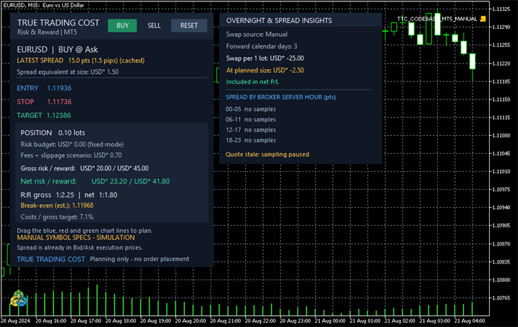
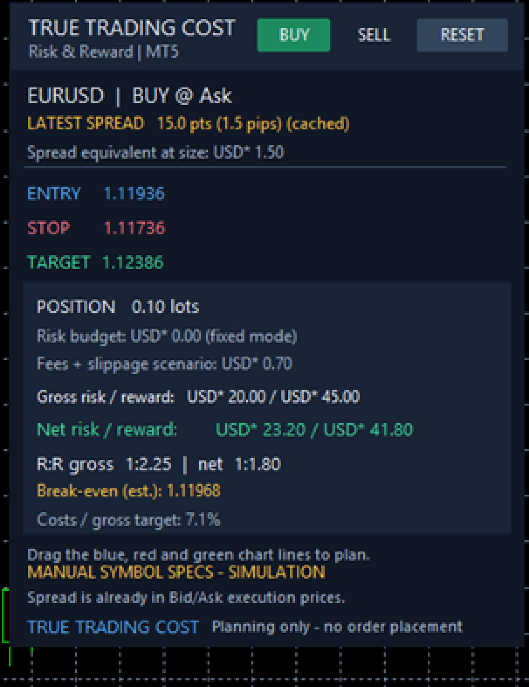
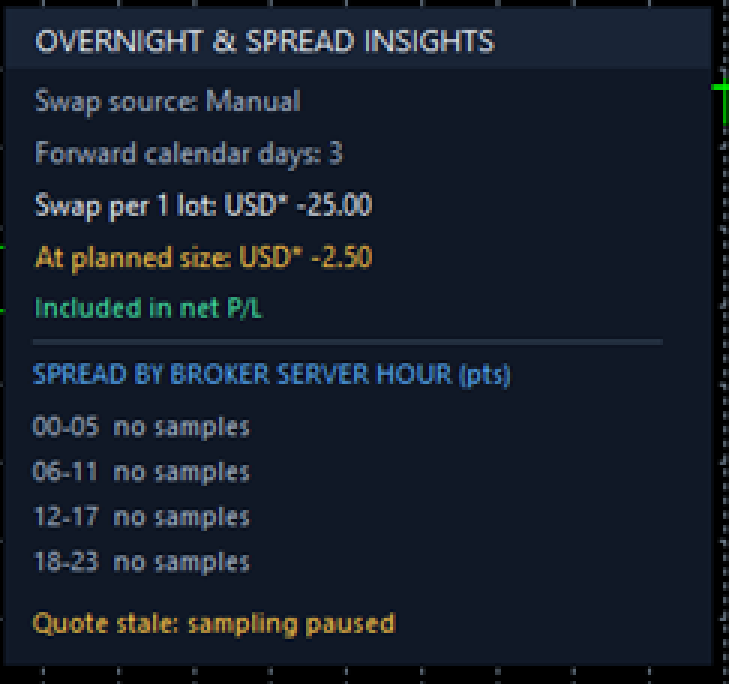

# True Trading Cost Planner — MT4 and MT5

**Free, open-source MetaTrader pre-trade cost and net risk/reward planner.** Model hypothetical BUY or SELL scenarios by dragging Entry, Stop Loss and Take Profit lines. This indicator does not place orders.

[**Download v1.20**](https://github.com/fxliner/true-trading-cost-planner-mt4-mt5/releases/tag/v1.20) · [**Full installation and calculation guide — FOREXREVIEW.TOP**](https://forexreview.top/2026/11/15/true-trading-cost-net-risk-reward-mt4-mt5/)

## What it can calculate

- Position size using equity risk percentage or fixed lots.
- Gross and estimated net risk/reward after round-turn commission, extra fees, assumed slippage and optional verified swap.
- Break-even price, current Bid/Ask spread, and spread-observation insights.
- Warnings about stale quotes, unverified commissions, invalid levels or unsuitable volume.
- BUY, SELL and RESET controls. **No trade execution or price predictions.**

## Original MetaTrader 5 screenshot

*Original chart image shows a manual-symbol-spec simulation, not a live trading result.*

### Details from the same image

*Enlargement of the original screenshot, not a separate trade.*

*Enlargement of the same original screenshot, not a separate trade.*

## Installation

1. Download the [combined ZIP](https://github.com/fxliner/true-trading-cost-planner-mt4-mt5/releases/download/v1.20/true-trading-cost-planner-mt4-mt5-v1.20.zip).
2. For **MT4**, copy the EX4 file in bin/MT4 to MQL4/Indicators; for **MT5**, copy the EX5 in bin/MT5 to MQL5/Indicators. Use **File > Open Data Folder**.
3. Restart or refresh Navigator > Indicators; attach the indicator to a chart.
4. Verify broker symbol specifications, commission and fees. Select BUY/SELL, move the lines, then inspect **net** R:R.

## Technical documentation

- [Installation and troubleshooting](docs/installation.md)
- [Source parameter reference](docs/parameters.md)
- [Cost model and assumptions](docs/cost-model.md)
- [Hypothetical calculation examples](docs/examples.md)
- [Frequently asked questions](docs/faq.md)
- [Manual validation checklist](docs/validation.md)

## Official resources

- [MQL5 Market MT5](https://www.mql5.com/en/market/product/209567)
- [MQL5 Code Base MT4](https://www.mql5.com/en/code/79598) and [MT5](https://www.mql5.com/en/code/79600)
- [Full usage tutorial](https://forexreview.top/2026/11/15/true-trading-cost-net-risk-reward-mt4-mt5/)
- [Trading tools and broker comparisons — FOREXREVIEW.TOP](https://forexreview.top/)

License: [MIT](LICENSE). Report issues using [GitHub Issues](https://github.com/fxliner/true-trading-cost-planner-mt4-mt5/issues/new/choose). Do not share passwords, account numbers or private trading data.

**Disclaimer:** Values are estimates, not guaranteed fills or profit forecasts. They depend on broker contract specifications, quote freshness, costs, account currency and actual execution.
